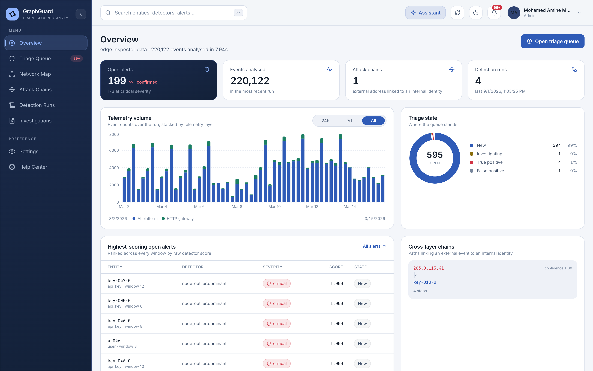
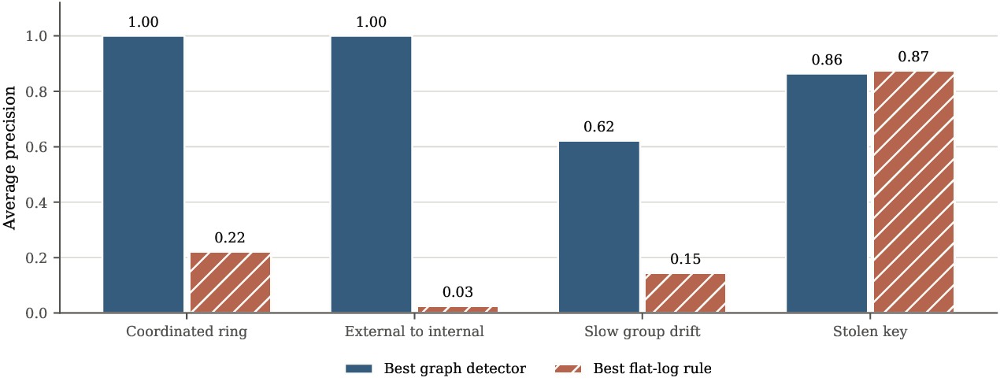
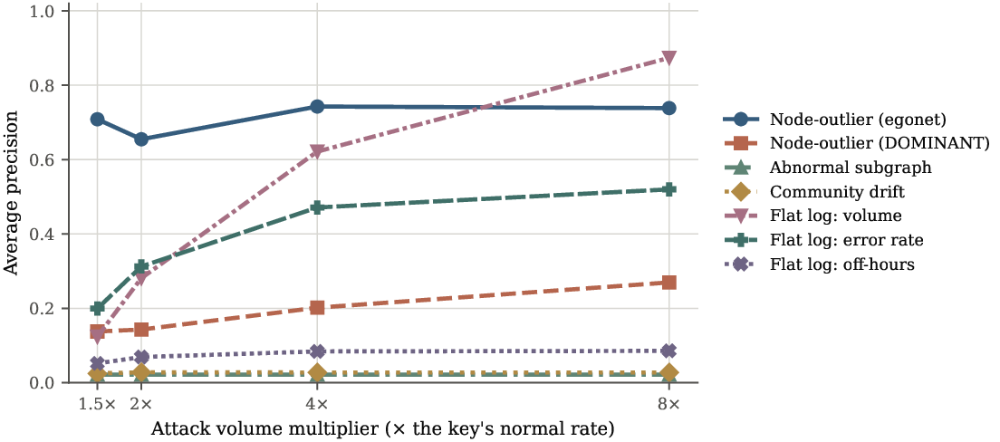
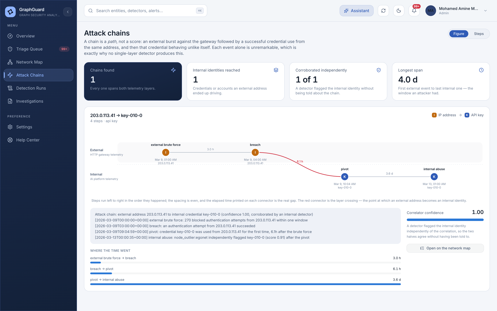

# GraphGuard

**Graph-based security analytics for AI-platform telemetry.**

GraphGuard turns the telemetry of an AI platform (API calls, sessions, gateway requests) into a
single **heterogeneous temporal graph**, runs **graph anomaly detection** on it, and gives a security
analyst **ranked, explained alerts** in a dashboard.

The idea behind it: a stolen API key, a ring of coordinated fake accounts, or an outsider who breaches
and pivots inward are almost invisible line by line, because every individual event looks benign.
The signal is in the *pattern of relationships over time*. A graph makes those relationships
computable; the fact that it can also be drawn is a secondary benefit.

GraphGuard scores and explains. It never blocks anything: a human decides.



> **All data in this repository is synthetic.** The simulator generates benign traffic and labelled
> attack scenarios from a fixed seed. No real platform telemetry was used, and every result below
> should be read in that light.

## What it does

| Stage | Component | Output |
|---|---|---|
| Ingest | Adapters on one canonical schema (OpenTelemetry GenAI `gen_ai.*`, HTTP access logs) | `TraceEvent` stream |
| Build | Heterogeneous temporal graph with time-windowed snapshots | PyG `HeteroData` |
| Detect | Node outliers · community drift · abnormal subgraphs | Explainable signals |
| Correlate | Cross-layer attack-chain reconstruction, MITRE ATLAS / OWASP LLM Top 10 tags | Ranked alerts, chains |
| Present | FastAPI service and React dashboard | Triage queue, network map, chains, investigations |
| Validate | Synthetic simulator and evaluation harness | Per-scenario metrics, baselines, figures |

### The three detectors

1. **Node-outlier scoring** — how far a node deviates from comparable peers or from its own past.
   Aimed at a **stolen API key**. Two implementations: a classical egonet baseline and PyGOD's
   DOMINANT graph autoencoder.
2. **Community drift** — the shape of a *group* changing across snapshots. Aimed at slow compromise,
   where no single member looks unusual.
3. **Abnormal-subgraph detection** — a small cluster acting in unison. Aimed at **coordinated
   abuse**: one actor driving many accounts.

Every detector returns a score, the contributing nodes and edges, and a plain-language reason.

### The five labelled scenarios

| Scenario | What it simulates |
|---|---|
| `stolen_key` | A valid API key abruptly behaves unlike its owner |
| `coordinated_ring` | Freshly created accounts driven by one actor in synchronised bursts |
| `slow_group_drift` | A whole cohort shifts gradually; no member is an outlier in any window |
| `external_to_internal` | Credential stuffing, then a valid key used from the same address, then abuse |
| `credential_stuffing` | Brute force that never breaches: the control that must produce no chain |

## Architecture

```
raw telemetry
     │
     ▼
ingestion adapters ── normalise ──► canonical TraceEvent stream
     │
     ▼
graph builder ──► heterogeneous temporal graph + time-windowed snapshots
     │
     ├───────────────┬────────────────────┐
     ▼               ▼                    ▼
node-outlier   community drift   abnormal-subgraph
     └───────────────┴────────────────────┘
     ▼
correlation ──► cross-layer chains, ranking, explanations, framework tags
     │
     ▼
platform (FastAPI · PostgreSQL · Celery · Redis) ──► React dashboard

simulator ──► benign + labelled attack telemetry        eval ──► metrics, baselines, figures
```

Three rules keep it extensible:

- Adapters emit only `TraceEvent`s; nothing downstream parses a raw log format.
- Only the graph builder knows graph internals; detectors consume a documented interface.
- `platform/` imports the analytics packages, and they never import it. The whole evaluation runs
  from the command line with no database, no Redis and no accounts.

More detail: [`docs/DESIGN.md`](docs/DESIGN.md), [`docs/ARCHITECTURE.md`](docs/ARCHITECTURE.md),
[`docs/SCHEMA.md`](docs/SCHEMA.md).

## Quickstart

Requires [`uv`](https://docs.astral.sh/uv/). Python 3.12 is pinned in `.python-version` and `uv`
fetches it if needed.

```bash
git clone https://github.com/amine-mosbah/GraphGuard.git
cd GraphGuard
uv sync --extra dev
```

### Reproduce the evaluation

No services are needed for this part.

```bash
uv run graphguard simulate     # ~5 s: 220,122 synthetic events into data/synthetic/
uv run graphguard evaluate     # ~10 s: simulate, build the graph, detect, score; saves to runs/
uv run graphguard figures      # ~35 s: regenerates docs/assets/figures/ (PDF + CSV)
```

The seed is fixed (`1337` in `config/default.yaml`), so `figures` rewrites the committed CSVs with
identical numbers. `uv run graphguard config show` prints the effective configuration.

### Run the dashboard locally

Needs Node.js for the frontend and a local Redis for the job queue. SQLite is enough for the
database in development.

```bash
export GRAPHGUARD_DATABASE_URL="sqlite+pysqlite:///$PWD/devdata.db"
uv run alembic upgrade head
uv run graphguard platform create-admin      # prompts for an email and a password (12+ characters)
```

Then, in three terminals (each with `GRAPHGUARD_DATABASE_URL` exported as above):

```bash
# 1. the API
uv run uvicorn graphguard.api.app:create_app --factory --port 8000

# 2. the worker that executes detection runs (requires Redis on localhost:6379)
uv run celery -A graphguard.platform.jobs:celery_app worker --loglevel=info --concurrency=1

# 3. the frontend
npm --prefix dashboard ci
npm --prefix dashboard run dev               # http://localhost:5173
```

Sign in, open **Detection Runs** and start a run. It takes about eight seconds and fills the triage
queue, the timeline, the attack chains and the network map.

A containerised stack (nginx, API, worker, PostgreSQL, Redis) is defined in `docker-compose.yml` and
described in [`docs/DEPLOYMENT.md`](docs/DEPLOYMENT.md). CI builds and smoke-tests the image; the
full stack has not been operated on a server.

## Tests

```bash
uv run pytest                  # 344 tests, about a minute
uv run ruff check .
uv run black --check .
uv run mypy src
```

The suite covers the schema, adapters, graph builder, the three detectors, cross-layer correlation,
the evaluation harness and the platform layer (auth, runs, triage, settings). It runs against
SQLite locally; CI repeats the platform tests against PostgreSQL. The dashboard is linted and
type-checked (`npm --prefix dashboard run lint`, `npm --prefix dashboard run build`) but has no
unit tests.

## Results

**These results come from synthetic scenarios only**, generated by the simulator in this repository
at seed 1337. They show how the detectors behave on attacks built to exercise them. They are not
evidence of performance on real traffic. The numbers are in
[`docs/assets/figures/`](docs/assets/figures/) as CSV and are regenerated by `graphguard figures`.

### Graph detectors against flat-log rules

Average precision of the best graph detector against the best of three flat-log rules (request
volume, error rate, off-hours activity), per scenario:



| Scenario | Best graph detector | AP | Best flat-log rule | AP |
|---|---|---|---|---|
| Coordinated ring | abnormal subgraph | 1.000 | error rate | 0.222 |
| External to internal | node outlier (egonet) | 1.000 | off-hours | 0.026 |
| Slow group drift | community drift | 0.622 | volume | 0.145 |
| Stolen key | node outlier (egonet) | 0.864 | volume | **0.875** |

On the stolen key the flat volume rule narrowly wins, because the default attack is loud (eight
times the key's normal volume). The loudness sweep below is what answers that.

### What happens when the attacker is quieter



On the stolen-key scenario alone, the flat volume rule falls from 0.874 at 8× volume to 0.124 at
1.5×, while the egonet node-outlier detector stays between 0.655 and 0.743. The two cross between
4× and 8×. The graph detector is the one whose performance does not depend on the attacker being
loud.

### Each detector on each scenario (ROC-AUC)

| Method | Coordinated ring | External to internal | Slow group drift | Stolen key |
|---|---|---|---|---|
| Node outlier (egonet) | 0.793 | 1.000 | 0.483 | 0.930 |
| Node outlier (DOMINANT) | 0.311 | 0.659 | 0.411 | 0.910 |
| Abnormal subgraph | 1.000 | 0.500 | 0.500 | 0.500 |
| Community drift | 0.843 | 0.551 | 0.867 | 0.552 |

Each detector leads on the mode it targets. `credential_stuffing` has no column because it
compromises no entity; it is the control for the chain search.

### Cross-layer chains

On the default dataset the correlator reconstructs exactly one attack chain, the injected
`external_to_internal` one, with both endpoints correct. The brute-force-without-breach control
yields no chain.

### Limitations

- **Synthetic-only validation.** The scenarios are the author's own, and a detector tuned and tested
  on the same simulator is not validated against real adversaries.
- **The learned detector lost.** DOMINANT scored below the classical egonet baseline on every
  scenario.
- The egonet detector is **below chance on slow group drift** (0.483), and drift is
  indistinguishable from legitimate change in a group's behaviour.
- A persistent attack erodes the per-entity baseline, and synchronised behaviour can be evaded by
  an attacker who adds jitter.

[`docs/THREAT_MODEL.md`](docs/THREAT_MODEL.md) and [`docs/DECISIONS.md`](docs/DECISIONS.md) (D9,
D12–D15) record these with their evidence.

## The dashboard



An overview, a triage queue with alert drill-down, a 3-D network map, the attack-chain view, run
history, investigations, settings and a help centre. Light and dark themes. An optional assistant
panel can call a language model through the platform's own API; it is off by default and was not
used in any result above.

## Repository layout

```
config/            runtime configuration (seed, simulator, detectors, evaluation)
docs/              design, architecture, schema, decisions, threat model, related work, figures
src/graphguard/
  schema/          canonical TraceEvent
  ingestion/       adapters: raw telemetry -> TraceEvent
  graph/           node/edge registry, graph builder, snapshots
  detection/       node-outlier, community drift, abnormal-subgraph
  correlation/     cross-layer chain reconstruction, framework tags
  simulator/       benign traffic and labelled attack scenarios
  eval/            metrics, flat-log baselines, figures
  api/             FastAPI application
  platform/        persistence, auth and RBAC, Celery jobs, triage workflow, /api/v1
dashboard/         React + TypeScript + Vite + Tailwind frontend
migrations/        Alembic migrations
tests/             pytest suite
```

## Documentation

- [`docs/DESIGN.md`](docs/DESIGN.md) — problem, concepts, scope and conventions
- [`docs/ARCHITECTURE.md`](docs/ARCHITECTURE.md) — pipeline, stage contracts, module map
- [`docs/SCHEMA.md`](docs/SCHEMA.md) — the canonical `TraceEvent` and graph schema
- [`docs/THREAT_MODEL.md`](docs/THREAT_MODEL.md) — attacker classes, scenarios, known limitations
- [`docs/DECISIONS.md`](docs/DECISIONS.md) — the decision log, with the reasoning for each choice
- [`docs/RELATED_WORK.md`](docs/RELATED_WORK.md) — literature map
- [`docs/DEPLOYMENT.md`](docs/DEPLOYMENT.md) — the containerised stack
- [`docs/ROADMAP.md`](docs/ROADMAP.md) — the original plan and its status

## Naming

"GraphGuard" is a working name and collides with unrelated published work: GraphGuard (NDSS 2024,
training-data misuse in graph neural networks) and GraphGuard (Reynisson, Schreyer & Borth, 2024,
credit-card fraud detection). See [`docs/RELATED_WORK.md`](docs/RELATED_WORK.md).

## Citation

This software accompanies the thesis:

> Mohamed Amine Ben Mosbah. *GraphGuard: Visual Analytics for AI-Security Telemetry.* National
> Engineering Diploma thesis, National Engineering School of Sousse (ENISo), University of Sousse,
> 2026.

```bibtex
@thesis{benmosbah2026graphguard,
  author      = {Ben Mosbah, Mohamed Amine},
  title       = {GraphGuard: Visual Analytics for AI-Security Telemetry},
  type        = {National Engineering Diploma thesis},
  institution = {National Engineering School of Sousse (ENISo), University of Sousse},
  year        = {2026}
}
```

The thesis document itself is not part of this repository.

## Acknowledgments

This project was developed during a Mitacs Globalink Research Internship at the Cyber Science Lab,
University of Guelph, as the graduation project for the National Engineering Diploma at ENISo.

## License

No license has been granted yet: all rights are reserved by the author. You are welcome to read the
code and run it to reproduce the results; please get in touch before reusing it.
