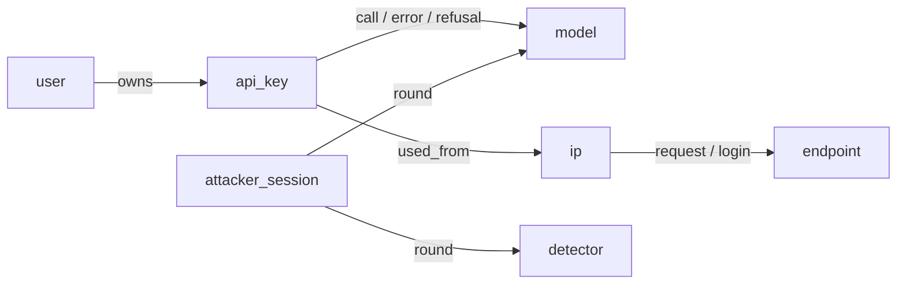

# SCHEMA.md — canonical `TraceEvent` and graph schema

> **Schema version: 1.0** · Implemented in [`src/graphguard/schema/`](../src/graphguard/schema/).
>
> This is the seam of the whole system. Adapters translate raw telemetry *into* it; every
> downstream component speaks *only* it. It is also the contract shared with the upstream **Phase 1**
> jailbreak project, so its labelled session traces drop straight into the graph builder with no
> converter (DESIGN.md §10). **Changing a field here is a cross-project change** — bump
> `SCHEMA_VERSION` and add a `DECISIONS.md` entry in the same commit.

---

## 1. The event model

One event is a single timestamped fact:

```
actor --[action]--> target        (with an outcome)
```

plus **context** that lets the graph builder materialise additional nodes and edges:
`session_id`, `source_ip`, and typed keys inside `attributes`.

### Fields

| Field | Type | Req. | Notes |
|---|---|:--:|---|
| `event_id` | `str` | auto | UUID4 hex; unique per event. |
| `timestamp` | `datetime` | ✅ | **Timezone-aware**, normalised to UTC. The temporal graph depends on it. |
| `layer` | `Layer` | ✅ | `ai` \| `http` \| `network`. |
| `session_id` | `str?` | | Groups multi-round interactions (a conversation, a login flow). |
| `actor_id` | `str` | ✅ | The "who". |
| `actor_type` | `ActorType` | ✅ | `user` \| `api_key` \| `ip` \| `host` \| `attacker_session`. |
| `target_id` | `str` | ✅ | The "what". |
| `target_type` | `TargetType` | ✅ | `model` \| `endpoint` \| `host` \| `service` \| `detector`. |
| `action` | `Action` | ✅ | `call` \| `error` \| `refusal` \| `login` \| `request` \| `file_access` \| `round`. Becomes the **edge type**. |
| `outcome` | `Outcome` | ✅ | `allow` \| `block` \| `refuse` \| `success` \| `error`. |
| `source_ip` | `str?` | | **Cross-layer join key** — validated as a real IP and normalised. |
| `attributes` | `dict` | | Free-form payload; well-known keys in §3. |
| `label` | `str?` | | Ground truth: `"benign"` or a scenario name. **`None` = unlabelled (production).** |
| `schema_version` | `str` | auto | Contract version; mismatches fail loudly on read. |

### Design rules, and why

Each of these exists because the obvious alternative causes a specific, hard-to-find bug.

1. **Timezone-aware timestamps are mandatory; naive ones are rejected.** Silently assuming UTC on
   an event from a foreign adapter is exactly the bug that corrupts a temporal analysis, and every
   detector here reasons about time. Adapters must be explicit.
2. **Node identity is `(type, id)`, never the bare id.** A user named `gpt-4o` and a model named
   `gpt-4o` must not collapse into one vertex.
3. **Events are immutable** (`frozen=True`). A detector must not be able to mutate the evidence it
   is scoring.
4. **Unknown fields are rejected** (`extra="forbid"`). An adapter typo fails at ingestion instead of
   silently dropping a field the graph builder was counting on.
5. **`source_ip` is validated and normalised as an IP address.** It is the vertex the HTTP and AI
   layers share; a malformed value would break cross-layer correlation *silently*, which is worse
   than failing.
6. **`label=None` means unlabelled, not benign.** Conflating "we know it's clean" with "we don't
   know" would inflate every evaluation metric. `is_attack` is False for both, but callers that
   need the distinction test `label is None`.
7. **`schema_version` is checked on read.** A mis-parsed trace file produces a wrong graph, and a
   wrong graph produces confident nonsense downstream.

---

## 2. Graph mapping

The graph builder is the only component that knows graph internals (DESIGN.md §8.3). It applies
these rules to a `TraceEvent` stream.

| Source | Becomes |
|---|---|
| `(actor_type, actor_id)` | a node |
| `(target_type, target_id)` | a node |
| the event itself | a **timestamped edge** of type `action`, carrying `outcome` + `attributes` |
| `source_ip` (when present) | an `ip` node, plus an edge `actor -[used_from]-> ip` |
| `attributes["user_id"]` (when present) | a `user` node, plus an edge `user -[owns]-> api_key` |
| `session_id` | edge attribute; groups rounds within a session |



The **`ip` node is the load-bearing part**: it is the single vertex where the HTTP layer and the AI
layer meet, which is what turns two unrelated incidents into one traversable path and makes
cross-layer attack-chain correlation possible at all (DESIGN.md §7).

### Temporal structure

Every edge carries a timestamp. The builder emits **time-windowed snapshots** (window and stride
configured under `graph.snapshot` in `config/default.yaml`). Community drift is defined *across*
these snapshots; node-outlier scoring runs *within* one, or over per-node history.

---

## 3. Reserved `attributes` keys

`attributes` is free-form so a new telemetry layer never forces a schema change. Keys that the
graph builder or detectors actually read are declared as constants in `schema.events.Attr`, so
they are discoverable rather than magic strings. AI-layer names follow the **OpenTelemetry GenAI
semantic conventions** (`gen_ai.*`) where an equivalent exists, which is what makes GraphGuard
deployable behind any OTLP collector.

| Constant | Key | Layer | Meaning |
|---|---|---|---|
| `Attr.USER_ID` | `user_id` | ai | Owning user of an `api_key` actor → `owns` edge. |
| `Attr.TOKENS_IN` | `gen_ai.usage.input_tokens` | ai | Prompt tokens. |
| `Attr.TOKENS_OUT` | `gen_ai.usage.output_tokens` | ai | Completion tokens. |
| `Attr.MODEL_NAME` | `gen_ai.request.model` | ai | Requested model. |
| `Attr.TEMPERATURE` | `gen_ai.request.temperature` | ai | Sampling temperature. |
| `Attr.LATENCY_MS` | `latency_ms` | ai/http | Round-trip latency. |
| `Attr.ERROR_TYPE` | `error_type` | ai/http | Error classification when `outcome=error`. |
| `Attr.STATUS_CODE` | `http.response.status_code` | http | HTTP status. |
| `Attr.ENDPOINT_PATH` | `url.path` | http | Request path. |
| `Attr.METHOD` | `http.request.method` | http | HTTP verb. |
| `Attr.USER_AGENT` | `user_agent.original` | http | Client UA string. |
| `Attr.PROMPT_ID` | `prompt_id` | ai | Phase 1: source behaviour/prompt identifier. |
| `Attr.ROUND_IDX` | `round_idx` | ai | Phase 1: round number within an adaptive attack. |
| `Attr.JUDGE_SCORE` | `judge_score` | ai | Phase 1: judge's success score for the round. |
| `Attr.DETECTOR_LABEL` | `detector_label` | ai | Phase 1: the content detector's decision. |
| `Attr.ATTACK_METHOD` | `attack_method` | ai | Phase 1: `pair` \| `tap`. |

> Phase 1 attributes are consumed as **edge attributes**, never as a GraphGuard detector's
> reasoning input. GraphGuard reasons relationally; content-level scoring stays in Phase 1
> (DESIGN.md §10 boundary discipline).

---

## 4. Examples

**AI layer — a normal model call**

```json
{"event_id":"9f1c…","timestamp":"2026-03-02T14:30:00Z","layer":"ai","session_id":"sess-1",
 "actor_id":"key-042","actor_type":"api_key","target_id":"gpt-4o","target_type":"model",
 "action":"call","outcome":"success","source_ip":"10.0.0.7",
 "attributes":{"user_id":"u-17","gen_ai.usage.input_tokens":120,"gen_ai.usage.output_tokens":380},
 "label":"benign","schema_version":"1.0"}
```

**HTTP layer — a failed login (credential stuffing, Layer 2)**

```json
{"event_id":"3a7d…","timestamp":"2026-03-02T02:14:09Z","layer":"http","session_id":null,
 "actor_id":"203.0.113.9","actor_type":"ip","target_id":"/v1/auth/login","target_type":"endpoint",
 "action":"login","outcome":"block","source_ip":"203.0.113.9",
 "attributes":{"http.response.status_code":401,"http.request.method":"POST"},
 "label":"credential_stuffing","schema_version":"1.0"}
```

**Phase 1 — an adaptive-jailbreak round that was blocked**

```json
{"event_id":"c02e…","timestamp":"2026-03-02T11:02:44Z","layer":"ai","session_id":"pair-run-88",
 "actor_id":"pair-run-88","actor_type":"attacker_session","target_id":"promptguard",
 "target_type":"detector","action":"round","outcome":"block","source_ip":null,
 "attributes":{"attack_method":"pair","round_idx":2,"judge_score":1,"detector_label":"jailbreak"},
 "label":"adaptive_jailbreak","schema_version":"1.0"}
```

---

## 5. On-disk format

JSONL — one event per line, append-friendly, streamable, and readable with `head`/`jq`. A `.gz`
suffix is compressed transparently. Reading is **lazy**, because telemetry files are expected to
outgrow memory and the graph builder consumes a stream.

```python
from graphguard.schema import read_jsonl, write_jsonl

write_jsonl(events, "data/benign.jsonl")
for event in read_jsonl("data/benign.jsonl"):
    ...
```

Failure modes are explicit: a malformed line raises `TraceParseError` **with its line number**, and
a version mismatch raises `SchemaVersionMismatchError` unless `strict_version=False` is passed to read
an archived run deliberately.

---

## 6. Versioning policy

| Change | Action |
|---|---|
| Add an optional field or a reserved `attributes` key | minor bump (`1.0` → `1.1`) |
| Rename/remove a field, or change a field's meaning | major bump (`1.0` → `2.0`) + `DECISIONS.md` entry + coordinate with Phase 1 |
| Add an enum member | minor bump; readers must tolerate unknown members gracefully |

Both projects stamp exports with `schema_version` so a mismatched trace file fails loudly instead
of silently producing a wrong graph.
